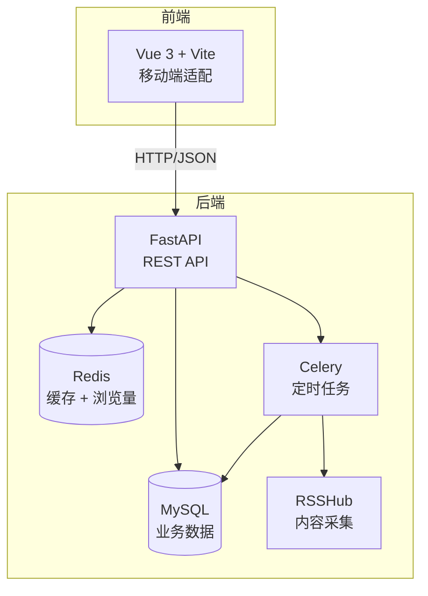

# 今日资讯

[](https://github.com/yybyiguo/Fast_API/actions/workflows/ci.yml)

一个移动端优先的资讯阅读应用，FastAPI + Vue 3 全栈实现，含 RSS 自动采集、Redis 浏览量异步落库、收藏/历史、用户认证等完整功能。

## 架构



## 技术栈

| 层 | 技术 |
|---|------|
| 前端 | Vue 3, Vite, Vue Router, 纯 CSS 移动端适配 |
| 后端 | FastAPI, SQLAlchemy 2.0 (async), Pydantic v2, Alembic |
| 数据库 | MySQL 8, Redis |
| 任务队列 | Celery (Redis broker), RSSHub 内容采集 |
| 测试 | pytest, pytest-asyncio, pytest-cov, ASGITransport 直连 |
| 工具链 | uv, ruff, GitHub Actions |

## 快速开始

### 后端

```powershell
cd backend

# 首次：复制本地配置模板，再按自己的 MySQL/Redis 修改
copy .env.example .env

# 安装依赖
uv sync

# 启动开发服务器
uv run uvicorn main:app --host 127.0.0.1 --port 8000

# 启动 Celery（RSS 采集、浏览量落库）
uv run celery -A tasks.celery_app worker --loglevel=info
uv run celery -A tasks.celery_app beat --loglevel=info
```

### 前端

```powershell
cd frontend
npm install
npm run dev
```

打开 <http://127.0.0.1:5500>

### Windows 本地一键启动（可选）

已经在本机装好 MySQL、Redis/Memurai、Python 3.13、Node 20+ 时，可以不用手动开多个终端：

```powershell
cd backend
copy .env.example .env    # 首次，按本机 MySQL/Redis 修改
cd ..
.\start-local.bat
```

- 脚本会自动找 `memurai.exe` / `redis-server.exe`（PATH、Program Files、常见安装目录）；
- Redis 装在别处时，设置环境变量 `REDIS_EXE`、`REDIS_CONF` 指向可执行文件和配置；
- `start-local.bat --dry-run` 只做检查，不启动任何服务；
- 停止用 `stop-local.bat`；
- 这个脚本只适用于 Windows；macOS/Linux 请用下面的 Docker Compose，或按“后端/前端”的手动命令启动。

### Docker Compose（一键起全套）

```powershell
# 构建镜像 + 跑迁移 + 起 mysql/redis/api/worker/beat/前端/rsshub
docker compose up -d --build

# 需要指标时，再叠加 observability profile
docker compose --profile observability up -d
```

| 入口 | 地址 |
|---|---|
| 前端 | <http://127.0.0.1:8080> |
| API | <http://127.0.0.1:8001> |
| RSSHub | <http://127.0.0.1:1200> |
| Prometheus | <http://127.0.0.1:9090> |
| celery-exporter | <http://127.0.0.1:9808/metrics> |
| MySQL | `127.0.0.1:3307` |
| Redis | `127.0.0.1:16380` |

- 配置在根目录 `.env.docker`，字段说明见 `.env.example`；生产环境务必改密码
- 日志：容器里 `LOG_TO_FILE=0`，统一走 stdout，用 `docker compose logs -f api` 查看；
  需要落文件就改成 `1` 并给容器挂载 `/app/logs`
- `/healthz` 只探进程存活；`/readyz` 检查 MySQL（必须）和 Redis（挂了返回 `degraded` 但仍 200）
- 应用指标：`http://127.0.0.1:8001/metrics`，Prometheus 抓 `api:8000/metrics` 和 `celery-exporter:9808`
- 慢查询日志：`docker compose exec mysql cat /var/lib/mysql/slow.log`

## 测试

```powershell
cd backend

# 跑测试（自动使用独立测试库 toutiao_test）
uv run pytest

# 带覆盖率
uv run pytest --cov --cov-report=term-missing

# 只跑接口测试
uv run pytest tests/test_news_api.py tests/test_user.py -v
```

## Lint

```powershell
cd backend

# 检查
uv run ruff check .

# 修复
uv run ruff check --fix .

# 格式化
uv run ruff format .
```

## 目录结构

```
toutiao/
├─ backend/                    # FastAPI 后端
│  ├─ main.py                  # 入口、中间件、异常处理
│  ├─ routers/                 # 路由层（user / news / favorite / history / rss）
│  ├─ curd/                    # 数据访问层
│  ├─ models/                  # SQLAlchemy 模型
│  ├─ schemas/                 # Pydantic 请求/响应模型
│  ├─ tasks/                   # Celery 任务（RSS 采集、浏览量落库）
│  ├─ cache/                   # Redis 缓存（列表、浏览量）
│  ├─ config/                  # 配置（数据库、缓存）
│  ├─ utils/                   # 工具（响应封装、认证、日志）
│  ├─ alembic/                 # 数据库迁移
│  ├─ tests/                   # 测试
│  ├─ conftest.py              # 测试 fixtures（ASGITransport、NullPool、依赖注入）
│  ├─ pyproject.toml           # uv 项目配置
│  └─ .github/workflows/ci.yml # CI
│
├─ frontend/                   # Vue 3 前端
│  ├─ src/views/               # 页面（Home / Detail / Login / Favorites / History / Profile）
│  ├─ src/api/                 # API 封装
│  ├─ src/stores/              # 状态管理
│  └─ src/composables/         # 组合式函数（分页、下拉刷新、无限滚动）
│
└─ README.md                   # 本文件
```

## 环境变量

后端读取 `backend/.env`，Docker Compose 读取根目录 `.env.docker`（示例见 `.env.example`）：

```env
DB_HOST=127.0.0.1
DB_PORT=3306
DB_USER=root
DB_PASSWORD=your_password
DB_NAME=toutiao

REDIS_HOST=127.0.0.1
REDIS_PORT=6379

APP_ENV=dev          # dev / prod
LOG_TO_FILE=1        # 0 关闭文件日志（CI 用）
```

RSSHub（内容采集）：

```env
RSSHUB_BASE=http://127.0.0.1:1200
RSS_ADMIN_USERS=your_username   # 可管理 RSS 订阅的用户名，逗号分隔
```

## API 概览

| 模块 | 路径前缀 | 功能 |
|------|---------|------|
| 用户 | `/api/user` | 注册、登录、资料、改密码 |
| 新闻 | `/api/news` | 分类、列表、详情、相关推荐 |
| 收藏 | `/api/favorite` | 切换、列表、清空 |
| 历史 | `/api/history` | 记录、列表、删除、清空 |
| RSS | `/api/rss` | 订阅管理、手动触发采集 |

## CI

GitHub Actions：push 到 main 或 PR 时自动跑

1. ruff lint + format check
2. pytest（MySQL 8 + Redis 服务容器）

见 [.github/workflows/ci.yml](.github/workflows/ci.yml)。
