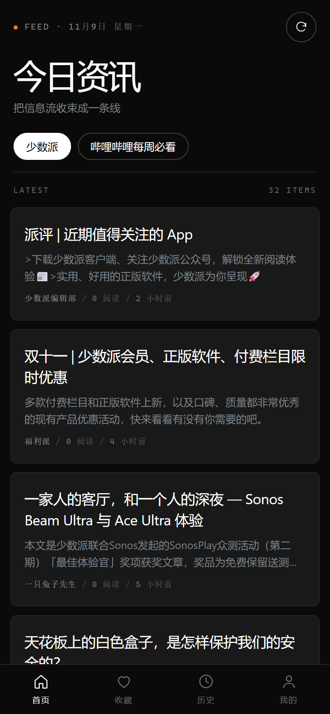
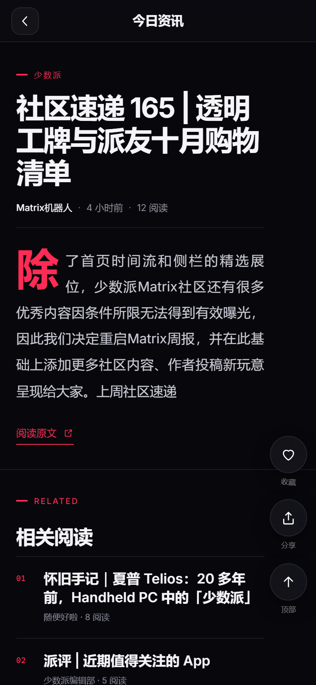
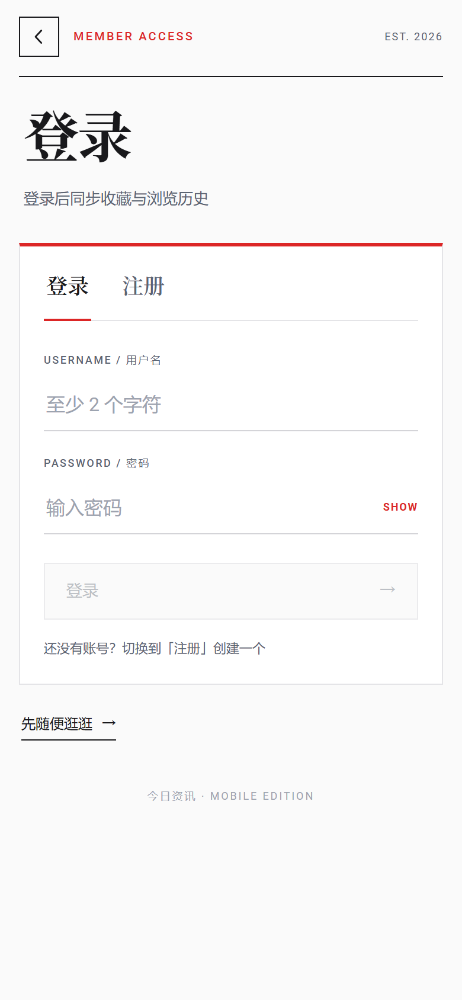
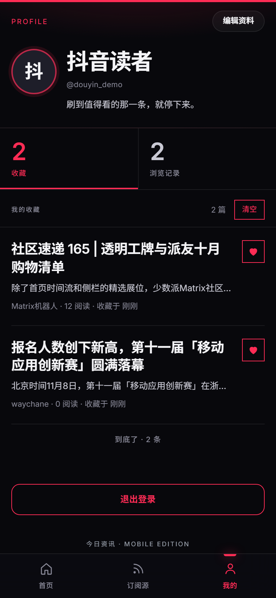
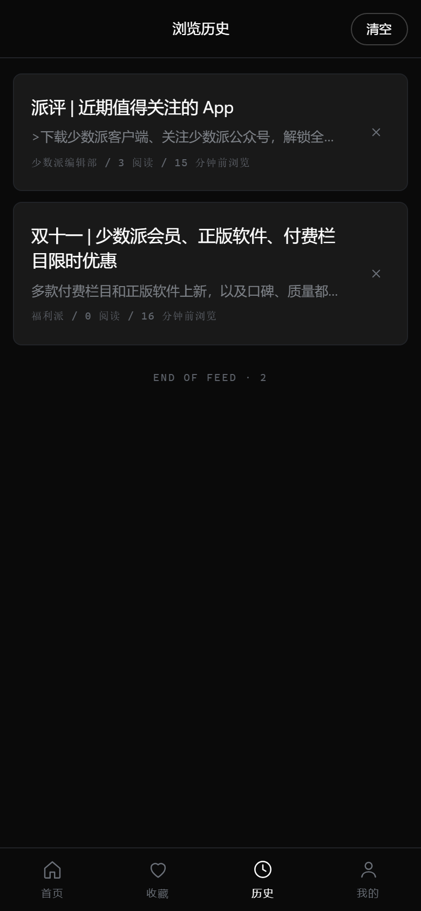
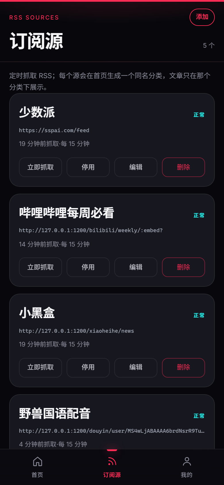
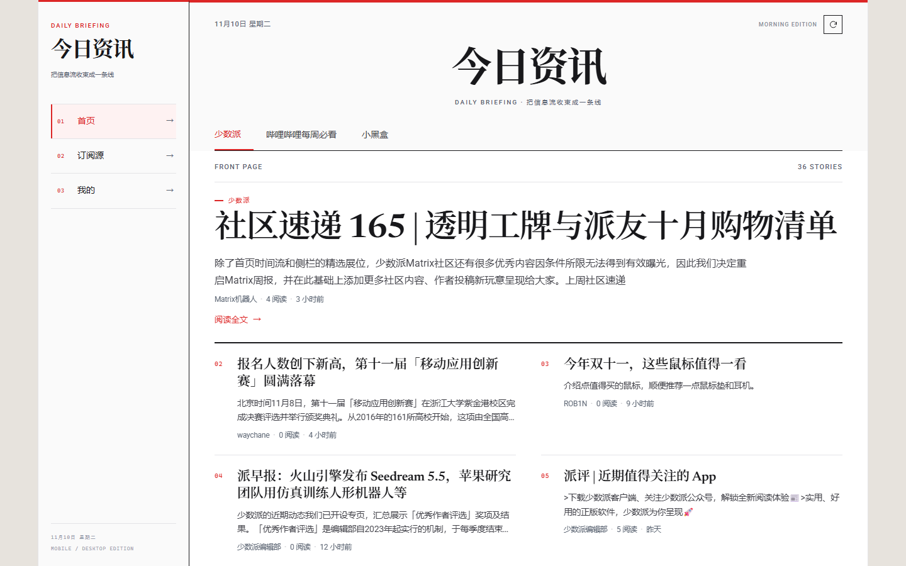
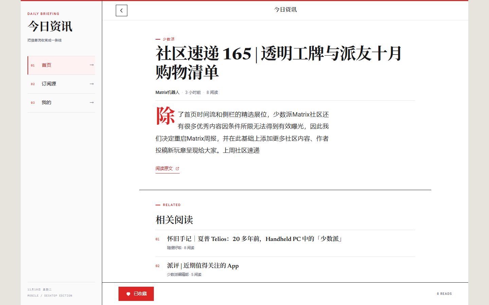
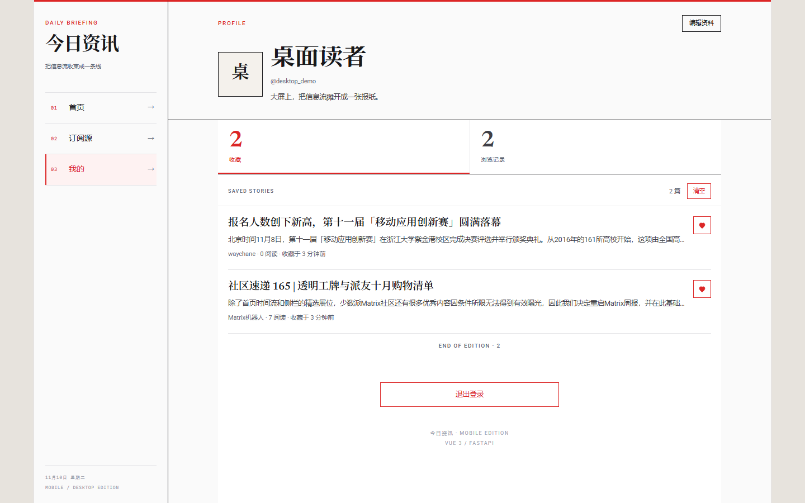

# 今日资讯 · 响应式前端

基于 **Vue 3 + Vite + Vue Router** 的移动端优先、桌面端适配的资讯阅读应用，对接 `backend/main.py` 提供的 FastAPI 接口（news / user / favorite / history）。后端代码未做任何修改。

## 功能

- **首页资讯流**：栏目切换（数据来自 `news_categories`）、分页加载、自定义下拉刷新、触底自动加载、骨架屏、空分类/加载失败状态
- **资讯详情**：浏览量自增、正文分段、相关推荐、收藏切换、进入详情自动记录浏览历史
- **登录 / 注册**：Bearer Token，`localStorage` 持久化，启动时自动校验，401 自动清理登录态；登录后回到原页面
- **我的**：资料展示与编辑（昵称 / 简介 / 性别）、收藏与浏览记录在同一页内切换（不跳页、不弹窗）、单条删除、行内二次清空、退出登录
- **订阅源**：作为底部一级入口，管理 RSS 源；非管理员显示无权限提示
- **移动端适配**：安全区、`100dvh`、底部 TabBar（首页 / 订阅源 / 我的）、下拉刷新、点击反馈、输入框防 iOS 缩放、`IntersectionObserver` 触底加载
- **桌面端适配**：≥960px 切换为左侧编辑式导航，底部 TabBar 自动隐藏；≥1200px 首页变为双栏报纸流，详情与「我的」使用居中阅读栏

## 界面风格

界面按 `ui-ux-pro-max` 的 **Editorial Grid / Magazine** 方向重塑：Newsreader 衬线标题 + 红色新闻强调 + 纸张底色 + 细黑分隔线；首页是「报头 + 头条 + 编号新闻列表」，正文使用首字下沉与约 34em 的阅读宽度。

## 效果预览

| 首页 | 详情 | 登录 |
| --- | --- | --- |
|  |  |  |

| 我的 · 收藏 | 我的 · 浏览记录 | 订阅源 |
| --- | --- | --- |
|  |  |  |

> 截图均为 390 × 844 视口真实渲染，数据来自本机 MySQL 的 `test` 库（RSS 抓取）。

## 桌面端效果

| 首页 | 详情 | 我的 |
| --- | --- | --- |
|  |  |  |

> 桌面截图均为 1440 × 900 视口：左侧固定导航 + 右侧内容区，首页双栏、详情单栏阅读。

## 快速开始

### 1. 启动后端（8000）

```powershell
cd backend
$env:PYTHONUTF8 = '1'
.\.venv\Scripts\python.exe -m uvicorn main:app --host 127.0.0.1 --port 8000
```

需要 MySQL（`test` 库）和 Redis（`localhost:6379`）都在运行，`.env` 已包含对应配置。

> `main.py` 启动时会 `print("✅ …")`，Windows 控制台默认 GBK 编码会报 `UnicodeEncodeError`，所以要先设 `PYTHONUTF8=1`。

### 2. 启动前端（5500）

```powershell
cd frontend
npm install
npm run dev
```

打开 <http://127.0.0.1:5500>，首次使用请到「我的」→「登录 / 注册」创建账号。

### 3. 真机调试

`vite.config.js` 设置了 `host: '0.0.0.0'`，终端会打印 `Network: http://192.168.x.x:5500/`，手机连同一 Wi-Fi 访问即可。接口由电脑上的 Vite 转发，手机不需要能访问 8000 端口。

## 目录结构

```
frontend/
├─ index.html                # viewport / 主题色
├─ vite.config.js            # 5500 端口 + /api 代理（不重写前缀）
└─ src/
   ├─ App.vue                # 壳层：router-view + TabBar + Toast
   ├─ router/index.js        # 路由与登录守卫
   ├─ api/
   │  ├─ http.js             # 请求封装、Bearer Token、错误归一化
   │  ├─ news.js             # 分类/列表/详情 + 字段清洗 + 空列表重试
   │  ├─ user.js             # 注册/登录/资料
   │  ├─ favorite.js         # 收藏 check/shift/list/clear
   │  └─ history.js          # 历史 add/list/delete/clear
   ├─ stores/
   │  ├─ auth.js             # 登录态（模块级单例）
   │  └─ categories.js       # 分类缓存（首页与详情共用）
   ├─ composables/
   │  ├─ usePagedList.js     # 分页列表状态机
   │  ├─ usePullRefresh.js   # 自定义下拉刷新
   │  ├─ useInfiniteScroll.js# 触底加载
   │  └─ useToast.js
   ├─ components/            # TabBar / NewsCard / AppHeader / EmptyState …
   ├─ views/                 # Home / Detail / Login / Profile / Rss
   ├─ utils/                 # 时间、浏览量、图片地址处理
   └─ styles/main.css        # 设计变量与全局重置
```

## 接口对接

| 页面 | 接口 |
| --- | --- |
| 分类 | `GET /api/news/categories` |
| 资讯列表 | `GET /api/news/list?categoryId=&page=&pagesize=` |
| 资讯详情 | `GET /api/news/detail?id=` |
| 注册 / 登录 | `POST /api/user/register`、`POST /api/user/login` |
| 个人信息 | `GET /api/user/info`、`PUT /api/user/update` |
| 收藏 | `GET /api/favorite/check`、`POST /api/favorite/shift`、`GET /api/favorite/list`、`DELETE /api/favorite/clear` |
| 历史 | `POST /api/historyadd_history`、`GET /api/history/list`、`DELETE /api/history/delete`、`DELETE /api/history/clear` |

### 为对齐后端做的兼容处理

后端接口本身有几处不统一，前端在 `src/api/` 里统一处理，没有改后端：

1. **代理不重写 `/api`**：后端路由本身就带 `/api` 前缀，Vite 直接转发，否则会 404。
2. **列表首次请求为空**：`curd/news.py::get_news_list` 在缓存未命中时把 `result.scalars().all()` 消费了两次，第一次返回空列表但已写入 Redis。前端检测到「列表为空且 total > 0」时自动补一次请求，命中缓存后恢复正常。
3. **字段命名不统一**：列表返回 `snake_case`，详情 / 收藏 / 历史返回 `camelCase`；`normalizeNewsItem` 同时兼容两套写法。
4. **拼写与分页字段**：列表总数是 `totol`（后端拼写），新闻分页是 `hasmore`，收藏/历史是 `has_more` —— 均已兼容。
5. **历史新增路径**：后端路由是 `/api/history/add_history`（prefix 拼接），前端按真实路径调用。
6. **收藏时间是 UTC**：`Favorite.created_at` 用 `datetime.utcnow`，而新闻、历史是本地时间；收藏时间单独按 UTC 解析后再显示「刚刚 / x 小时前」。
7. **图片与头像不可用**：`image` 常见值是 `"无"` 或 `null`，默认头像 `file\p1.jpg` 也不是可访问 URL，且后端没有挂载静态目录。前端只渲染 `http(s)` 图片，其余走文字占位。
8. **用户信息带密码哈希**：`userInfoResponse` 会返回 `password` 字段，前端 `normalizeUser` 只保留 UI 需要的字段，不会渲染或存储密码。
9. **错误格式**：业务错误是 `{ code, message, data }` 且 HTTP 状态码真实（401/400/404/500），422 是 FastAPI 默认的 `detail` 数组；`http.js` 统一转成中文 `ApiError`。

## 移动端适配要点

- `viewport-fit=cover` + `env(safe-area-inset-*)`，刘海屏与底部手势条不遮挡内容
- 页面用 `100dvh` 布局，地址栏收起/展开时高度正确；TabBar 作为 flex 子项参与布局，不遮挡列表
- 下拉刷新自己接管 `touchmove`（`passive: false`），配合 `overscroll-behavior` 关闭浏览器自带刷新
- 触底加载用 `IntersectionObserver`，`root` 指向每个页面自己的滚动容器
- 输入框统一 16px，避免 iOS 聚焦自动放大；按钮提供 `:active` 缩放反馈
- 时间、浏览量使用 `tabular-nums`，数字不抖动

## 构建

```powershell
npm run build     # 输出 dist/
npm run preview   # 预览构建产物，5500 端口
```

路由使用 History 模式，部署到静态服务器时需要配置 SPA fallback（所有未知路径回退到 `index.html`）。若要直连后端而不走代理，可设置：

```powershell
$env:VITE_API_BASE = 'http://127.0.0.1:8000'
```

此时会发起跨域请求，后端 CORS 只放行 5500 端口，前端必须跑在 5500。

## 顺带发现的后端小问题（未修改）

- `curd/news.py::get_news_list` 重复消费 Result（见上，前端已兜底）
- `routers/history.py` 的 `@router.post('add_history')` 少了斜杠，路径变成 `/api/historyadd_history`
- `routers/user.py` 的修改密码接口把用户输入当旧密码校验，实际不可用；前端未暴露该功能
- `curd/user.py::update_user` 里 `get_user_by_username(...)` 没有 `await`，后端会打印 `RuntimeWarning`
- `Favorite.created_at` 使用 UTC、其他表使用本地时间，时区不统一
